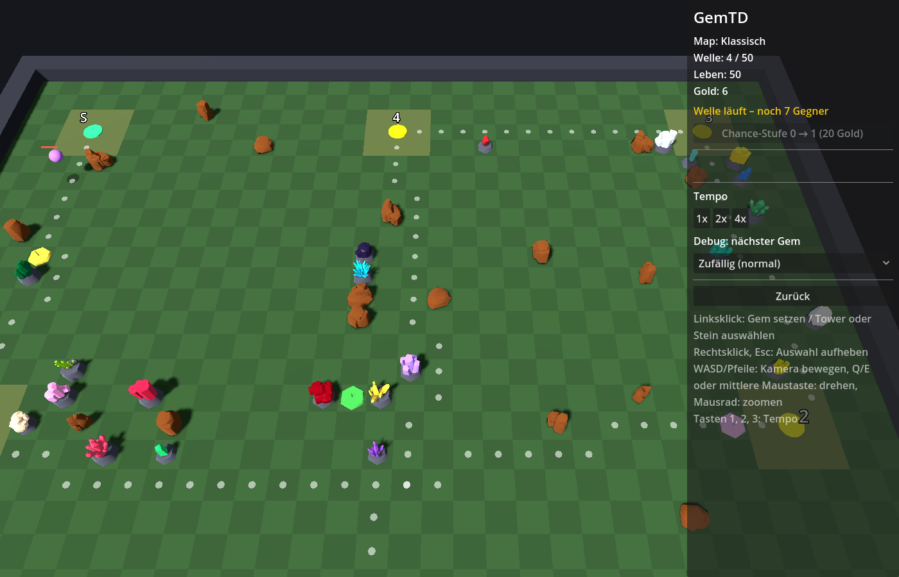

# TD Hub

Drei Tower-Defense-Spiele in einem, gebaut mit Godot 4 (GDScript, 3D): **GemTD**, **eeveTD** und **Shopping Maul**.
Alle drei sind Nachbauten bekannter Warcraft-3-Karten, spielbar allein, im Koop oder online über die Lobby.



| Modus | Vorbild | Stil | Spieler |
|---|---|---|---|
| **GemTD** | [BK's] Gem Tower Defense v3.1 (Bryvx), Gegner aus Gem TD+ 1.6.14 | Arcade-Neon | 1–8 |
| **eeveTD** | eeve! TD v1.01 (geX) | Druidenhain | 1–4 |
| **Shopping Maul** | Shopping Maul 5.44f | Art déco | 1–8 |

## Die Modi

### GemTD
Jede Runde fünf zufällige Gems aufs Feld setzen und damit ein Labyrinth bauen. Einer davon bleibt als Tower,
die anderen werden zu Steinen. Gleiche Gems lassen sich zu höheren Qualitäten kombinieren, aus passenden Zutaten
entstehen Spezial-Tower (Silber, Malachit, Sternrubin, Uran 238, Stein von Bryvx …) und Fallen. 50 Wellen mit Boden-,
Massen-, Flieger- und Bosswellen, Wertung nach Leben oder Punkten.
Regeln, Bedienung und Datenformate ausführlich: [docs/gemtd.md](docs/gemtd.md), alle Tower-Werte: [docs/tower-werte.md](docs/tower-werte.md).

### eeveTD
Barrikaden bauen und zu Element-Towern aufwerten (Natur, Erde, Feuer, Sturm, Magie, Wasser). 57 Level mit
Herausforderungen, sechs Schwierigkeiten von „Anfänger“ bis „IMPOSSIBLE!“, Fallen, ein Dual-Grundturm und
15 Dual-Tower. Gespielt wird in einem Wald mit Friedhof und Bergwerk, auf Wunsch bei Nacht.
Regeln ausführlich: [docs/eevetd.md](docs/eevetd.md).

### Shopping Maul
Jeder Spieler eröffnet eine Filiale (Media Markt, Aldi, Obi, IKEA …), kauft dort Tower und wertet sie auf.
Gegner laufen durch die Gebiete aller Spieler ins gemeinsame Ziel, nach Level 40 folgen 10 Bonuslevel.
Erfahrungspunkte bleiben zwischen den Partien erhalten und schalten neun Profi-Filialen frei (Post, Waffenladen,
Bestattungsinstitut …). Regeln ausführlich: [docs/shopping-maul.md](docs/shopping-maul.md).

## Spielen

**Fertige Version:** Windows-Builds heißen `GemTD_V0_<N>.zip` (aktuell V0.71) und liegen unter
[Releases](https://github.com/Tulkor/TDHub/releases). Entpacken, `.exe` starten.

**Aus dem Quellcode:** Godot 4.3 (oder neuer 4.x) öffnen → *Importieren* → `project.godot` → F5.

Im Hauptmenü *Einzelspieler* (Modus und Map wählen) oder *Mehrspieler*. Vor Runde 1 fragt ein Fenster nach
Schwierigkeit und weiteren Einstellungen. Sprache Deutsch oder Englisch, Fenster, Auflösung, UI-Größe und
Lautstärke stehen unter *Einstellungen* (auch im Escape-Menü während des Spiels).

Spielstände lassen sich jederzeit speichern, auch mitten in einer Welle, und über *Spiel laden* fortsetzen.
Die Run-History zeigt vergangene Partien.

**Kamera:** WASD/Pfeile oder Maus an den Rand bzw. rechte Maustaste ziehen verschiebt, Q/E oder mittlere
Maustaste dreht, Mausrad zoomt. Tasten 1/2/3 ändern das Tempo.

## Mehrspieler

In der Lobby stimmen alle über den Modus ab. Jeder Spieler bekommt eine Feldnummer: gleiche Nummer heißt
gemeinsames Feld (Koop), verschiedene Nummern heißt jeder spielt sein eigenes Feld und kann den anderen zuschauen.
Shopping Maul läuft immer als Koop, jeder in seinem Gebiet. Beim Koop rechnet der erste Spieler der Gruppe,
die anderen schicken ihm ihre Befehle.

**Verbinden:** Standardmäßig läuft alles über den Relay-Server `schulak.synology.me:24565` (Feld „Server“ in der
Lobby). Der Host bekommt einen Lobby-Code aus fünf Zeichen, die anderen tippen ihn ein, niemand muss Ports
freigeben. Wer das Feld leert, verbindet sich direkt über IP (UDP-Port 24565, im LAN oder mit Portfreigabe).
Einen eigenen Relay aufsetzen (Docker, Synology): [tools/relay/README.md](tools/relay/README.md).

## Editoren und Daten

Alles ist datengetrieben: Maps, Tower, Gegner, Wellen und Regeln stehen als JSON unter `data/`, neue Inhalte
brauchen keinen Code. Dateien unter `user://data/<typ>/` werden zusätzlich geladen und überschreiben gleiche IDs.

- **Map-Editor:** Kacheln malen, Spawn, Ziel und Checkpoints setzen, der Weg wird live angezeigt, *Testen* startet das Spiel.
- **Tower-Editor:** Stufen, Fähigkeiten, Rezepte, Upgrades und Effekte bearbeiten, *Speichern und im Spiel testen*.
- Ein Feld ist eine halbe Towerbreite (64 WC3-Einheiten), Tower belegen 2×2 Felder.

```
data/          balance.json, modes.json, maps/, towers/, enemies/, waves/, eeve.json, maul/, fx/, i18n/en.json
assets/        Modelle, Effekte, Schriften, Sounds, Texturen (je mit QUELLEN.md bzw. CREDITS.md)
scenes/        Hauptmenü, die drei Spiele, Map- und Tower-Editor (Oberfläche wird im Code gebaut)
scripts/
  autoload/    Database (lädt data/), Session, Net (Lobby, Sitzungen), Loc (Sprache), Sfx, Display
  game/        GemTD und eeveTD: Spielablauf, Tower, Gegner, Fähigkeiten, HUD, Spielstände
  maul/        Shopping Maul
  map/         Kartenformat, Wegsuche, Spielfeld und Feld-Stile
  net/         Koop-Abgleich, Zuschauen, Relay-Verbindung
  ui/          Themes (Arcade, Druidenhain, Art déco), Menüs, Lobby
  editor/      Map- und Tower-Editor
tests/         automatische Tests (auch Host + Client als getrennte Prozesse)
tools/         Werkzeuge für Tests, Builds, Screenshots, Balance, Daten und Assets
docs/          Regeln der drei Modi, Tower-Werte, WC3-Referenz
```

## Entwicklung

- Tests: `tools/run_tests.sh` (schnelle Auswahl), `tools/run_tests.sh alle` (dazu Balance, Tempo, späte Wellen),
  einzeln z. B. `tools/run_tests.sh smoke koop`.
- Vor einem Pull Request: `tools/vor_pr.sh` zieht main nach, startet die passenden Tests und meldet `BEREIT`.
- Windows-Build: `tools/build_windows.sh`, Export-Preset „Windows“ in `export_presets.cfg`.
- Texte stehen im Code auf Deutsch in `tr("…")`, die englische Übersetzung in `data/i18n/en.json`;
  `python3 tools/pruefe_ui.py` findet fehlende Einträge.
- Weitere Werkzeuge und Konventionen: [CLAUDE.md](CLAUDE.md).

## Credits und Lizenzen

Der Quellcode von TD Hub steht unter der **GNU General Public License v3.0** ([LICENSE](LICENSE)). Das gilt nur für den
eigenen Code und die eigenen Daten; Modelle, Effekte, Sounds, Schriften und Texturen behalten ihre eigenen Lizenzen (unten).
Im Spiel zeigt der Hub alle Nennungen unter „Mitwirkende“ (`data/credits.json`).

Ins Repo kommt nur, was öffentlich liegen und mit dem Spiel verkauft werden darf. Fast alles ist CC0:

- **Modelle:** Crystal Pack (iPoly3D), Rocks, Stylized Nature MegaKit, animierte Monster u. a. von Quaternius (CC0).
  Boss-Modell: *Little Man* von Don Carson, [CC-BY 3.0](https://creativecommons.org/licenses/by/3.0/),
  über [Poly Pizza](https://poly.pizza/m/8KU4S7I0sL8). Liste: [assets/models/CREDITS.md](assets/models/CREDITS.md)
- **Effekte:** Kenney Particle Pack, Brackeys VFX Bundle, Kronbits Particle Pack (alle CC0):
  [assets/fx/QUELLEN.md](assets/fx/QUELLEN.md)
- **Sounds:** eigene Aufnahmen von Lukas und Sounds von Pixabay ([Pixabay Content License](https://pixabay.com/service/license-summary/)):
  [assets/sounds/QUELLEN.md](assets/sounds/QUELLEN.md)
- **Schriften:** DejaVu Sans Mono (eigene freie Lizenz), Limelight, Federo, Uncial Antiqua, Alegreya (SIL OFL),
  Lizenztexte in `assets/fonts/`
- **Texturen:** Bodenfotos von Unsplash ([assets/textures/ground/CREDITS.md](assets/textures/ground/CREDITS.md)),
  Sternenhimmel aus Space 3D von wwwtyro, Unlicense ([assets/textures/sky/CREDITS.md](assets/textures/sky/CREDITS.md))

Die Originalkarten gehören ihren Autoren (Bryvx für Gem TD, geX für eeve! TD, die Autoren von Shopping Maul).
TD Hub ist ein Fan-Nachbau und steht in keiner Verbindung zu Blizzard Entertainment.
