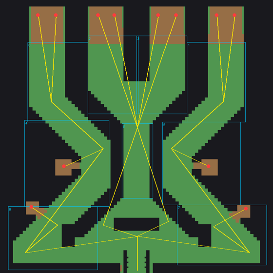

# Randgruppen TD: Designdokument

Vierter Modus im TD Hub. Vorbild ist die Warcraft-3-Karte **„Randgruppen TD2 UltraMods race addet by mufusion“**
(Fan-Mod von *Randgruppen TD2 vers.2b*, Braineaters Productions, deutsch, WC3 1.24–1.28). Alle Werte stammen aus
der Kartendatei selbst, ausgelesen mit `tools/wc3/auslesen.sh`; die Rohdaten liegen unter
`/mnt/project-files/konzepte/recherche-stand/randgruppen/`.

Erzeugt werden die Spieldaten mit `python3 -I tools/wc3/randgruppen/rg_daten.py`, die Tabellen unten mit
`python3 -I tools/wc3/randgruppen/rg_md.py`.

## Umbenennung (wichtig)

Die Originalkarte ist eine Satire, die fast ausschließlich mit Klischees arbeitet: Rassen und Tower sind
Herkunftsgruppen, Homosexuelle, Kranke (AIDS, Lepra, Parkinson), Neonazis samt NS-Figuren als spielbare Helden,
echte Prominente und Pornodarstellerinnen; dazu Beleidigungen im Chat und in den Meldungen. Nichts davon kommt ins
Spiel. Übernommen werden nur die **Spielmechanik und die Zahlen**. Jede Rasse, jeder Tower und jeder Gegner hat einen
neuen Namen mit derselben Rolle im Spiel; die Verbindung zur Karte hält nur die WC3-ID (Feld `wc3` in den Daten).
Originalnamen stehen bewusst nirgends im Repo.

Neue Rahmenhandlung: Die **Randgruppen** der Stadt (Kleingärtner, Zocker, Zirkus, Studenten-WG …) verteidigen die
**Hochburg der Toleranz** gegen **die Spießer**, die in 35 Leveln anrücken. Der Endgegner ist **Der Oberspießer**.

## Regeln (aus dem Kartenskript)

| Punkt | Original | Daten |
|---|---|---|
| Spieler | bis 10, jeder hat eine eigene Bauzone (9 Zonen), Leben gemeinsam | `zones`, `lanes` in der Karte |
| Start | 550 Gold, 0 Holz; ein Hauptgebäude, das einen Baumeister (= Rasse) für 500 Gold ausbildet | `start_gold`, `builder_cost` |
| Rassen | 11 Baumeister mit je 7 Towern | `races` |
| Endtower | 7. Tower jeder Rasse: kostet 1 Holz und geht nur, wenn die anderen 6 Tower der Rasse stehen | `rg.ultimate`, `rg.requires` |
| Holz | 1 Holz für alle beim Erreichen von Level 25 (sonst keins) | `lumber` |
| Level | 35, je Level ein Gegnertyp; jedes 5. Level fliegt; Level 35 ein einzelner fliegender Boss | `levels` |
| Ablauf | erstes Level nach 60 s, danach 30 s Pause, sobald alle Gegner tot oder durch sind | `first_pause`, `pause` |
| Gold | Kopfgeld je Kill (1–5) und am Levelanfang 10 + 2 × Level für jeden | `level_gold` |
| Mittelzone | der Spieler in der hellblauen Mitte bekommt 50 % Levelgold extra (dort laufen zwei Bahnen zusammen) | `center_bonus` |
| Leben | nach Schwierigkeit 50 / 35 / 25 / 10 / 1; Rot wählt in den ersten 30 s, sonst 25 | `difficulties` |
| Durchgelaufen | −1 Leben; der Boss in Level 35 kostet alle Leben | `boss_level` |
| Sieg | Level 35 überstanden | |
| Verkaufen | jeder Tower für 75 % | `sell_factor` |
| Aufräumer | zwei unverwundbare Einheiten am Rand schießen alle 25 s für 10 000 Schaden auf irgendeinen Gegner der Karte (gegen festhängende Gegner), bis Level 34 | `anti_stuck` |
| Fremde Zone | wer in eine fremde Zone läuft, wird zurückgesetzt (abschaltbar mit `-off`) | Zonen in der Karte |
| Spieler geht | seine Tower gehen an einen zufälligen Mitspieler; Rot kann Spieler bannen | |

Schadensarten und Rüstungsarten sind die von Warcraft 3 (Tabelle bis Patch 1.28 in `damage_table`). Tower haben die
Angriffsarten Normal, Durchbohrend, Belagerung, Magie, Zauber, Held und Chaos; die Gegner Rüstung Leicht, Mittel,
Befestigt, Normal.

Nicht übernommen: Chat-Befehle mit Beleidigungen, Witze-Quests, die „Penisverlängerung“ (eine Forschung ohne
Wirkung) und alle Meldungstexte.

## Karte

Stadtkarte (Cityscape), 84 × 84 Kacheln, bei uns 168 × 168 Felder (ein Feld = 64 WC3-Einheiten, Tower 2 × 2).
Die Gegner laufen von oben nach unten durch drei Stränge, die in der Mitte unten zusammenkommen; die Hochburg steht
unten in der Mitte.

| Zone | Spieler | Spawns (Anzahl je Spawn) | Weg danach |
|---|---|---|---|
| Rot (oben links) | 1 | 2 × oben | → Orange → Grün → Hochburg |
| Gelb (oben rechts) | 2 | 2 × oben | → Lila → Rosa → Hochburg |
| Blau, Türkis (oben Mitte) | 3, 4 | je 2 × oben (Level 35: je 1 Boss) | → Hellblau (Mitte) → Hochburg |
| Orange, Lila (Mitte links/rechts) | 5, 6 | je 1 × Mitte | → Grün bzw. Rosa |
| Grün, Rosa (unten) | 7, 8 | je 1 × unten | → Hochburg |
| Hellblau (Mitte) | 9 | keiner | → Hochburg |

Im Original spawnen **alle** Spawns, egal wie viele Spieler da sind. Bei uns spawnen nur die Bahnen von Zonen mit
Spieler (wie bei Shopping Maul), sonst wäre die Karte allein nicht spielbar. Einzelspieler bekommt Rot; die Gegner
laufen danach durch die leeren Zonen Orange und Grün zur Hochburg.

Die Zonen sind offene Flächen, die Gegner laufen mitten hindurch: Man baut ein **Labyrinth** wie in GemTD, nur mit
gekauften Towern.

## Rassen und Tower

Reihenfolge innerhalb der Rasse nach Preis, der 7. ist der Endtower. Schaden je Treffer, DPS ohne Rüstung,
Reichweite in Towerbreiten (128 WC3-Einheiten). Abklingzeit 0 im Original („so schnell wie die Animation“) steht
hier als 0,3 s. Fähigkeiten: Frostangriff = verlangsamt, Gift = Schaden pro Sekunde (Werte der WC3-Standards,
gerundet). Der „Ruhestörer“ gehört im Original zu zwei Rassen (Zocker und WG).

#### Schnäppchenjäger

Masse statt Klasse: extrem billige Tower, viele davon.

| # | Tower | Gold | Schaden | Abkl. s | DPS | Reichw. | Art | Besonderes |
|---|---|---|---|---|---|---|---|---|
| 1 | Wühltisch-Kunde | 5 | 7–13 | 1 | 10 | 4.3 | Magie |  |
| 2 | Coupon-Sammler | 20 | 27–33 | 1 | 30 | 5.08 | Durchbohrend |  |
| 3 | Sperrmüll-Sammler | 65 | 65–85 | 0.9 | 83 | 5.47 | Belagerung | Fläche 0.62 |
| 4 | Flohmarkt-Profi | 130 | 79–91 | 0.6 | 141 | 7.42 | Zauber |  |
| 5 | Ramschhändler | 175 | 107–163 | 0.6 | 225 | 7.42 | Magie |  |
| 6 | Schlussverkauf-Stürmer | 425 | 206–236 | 0.29 | 762 | 7.81 | Normal | Fläche 0.35, verlangsamt 25 % |
| 7 | Mister Sonderpreis | 750 | 801–900 | 0.3 | 2835 | 23.44 | Chaos | 1 Holz, braucht die anderen 6 |

#### Spätkauf

Alles aus dem Kiosk um die Ecke: viel Flächenschaden, teuer und stark.

| # | Tower | Gold | Schaden | Abkl. s | DPS | Reichw. | Art | Besonderes |
|---|---|---|---|---|---|---|---|---|
| 1 | Brausepulver | 15 | 14–18 | 0.85 | 18 | 5.08 | Durchbohrend |  |
| 2 | Grillanzünder | 55 | 36–60 | 0.4 | 120 | 5.08 | Belagerung | Fläche 0.7 |
| 3 | Zuckerschock | 125 | 70–115 | 0.4 | 231 | 6.25 | Magie |  |
| 4 | Leuchtreklame | 165 | 169–197 | 1.3 | 140 | 10.94 | Normal | Fläche 0.62 |
| 5 | Energydrink | 300 | 194–218 | 0.4 | 515 | 6.64 | Belagerung | Fläche 0.51 |
| 6 | Dreifach-Espresso | 410 | 376–406 | 0.3 | 1303 | 4.69 | Durchbohrend | Fläche 0.27 |
| 7 | Der Kioskkönig | 850 | 901–1000 | 0.3 | 3168 | 23.44 | Chaos | 1 Holz, braucht die anderen 6 |

#### Kleingartenverein

Solide Allrounder, Flächenschaden und ein Rasensprenger, der verlangsamt.

| # | Tower | Gold | Schaden | Abkl. s | DPS | Reichw. | Art | Besonderes |
|---|---|---|---|---|---|---|---|---|
| 1 | Gartenzwerg | 12 | 14–18 | 1 | 16 | 6.25 | Durchbohrend |  |
| 2 | Heckenschneider | 45 | 51–57 | 1 | 54 | 5.86 | Durchbohrend |  |
| 3 | Hochsitz | 90 | 65–85 | 0.5 | 150 | 5.47 | Belagerung | Fläche 0.62 |
| 4 | Vereinsheim | 140 | 104–116 | 0.8 | 137 | 5.47 | Zauber |  |
| 5 | Vereinswart | 230 | 147–203 | 0.75 | 233 | 7.42 | Magie |  |
| 6 | Rasensprenger | 375 | 226–256 | 0.4 | 602 | 7.81 | Normal | Fläche 0.35, verlangsamt 25 % |
| 7 | Der Obmann | 750 | 801–900 | 0.3 | 2835 | 23.44 | Chaos | 1 Holz, braucht die anderen 6 |

#### Laientheater

Große Reichweite, verlangsamt und vergiftet die Gegner.

| # | Tower | Gold | Schaden | Abkl. s | DPS | Reichw. | Art | Besonderes |
|---|---|---|---|---|---|---|---|---|
| 1 | Statist | 10 | 14–18 | 0.9 | 17 | 7.81 | Magie |  |
| 2 | Kühler Kritiker | 40 | 21–27 | 1 | 24 | 10.94 | Normal | verlangsamt 25 % |
| 3 | Intrigantin | 90 | 80–110 | 0.9 | 105 | 11.72 | Normal | Gift 4/s |
| 4 | Stepptänzer | 135 | 78–150 | 0.2 | 570 | 3.52 | Chaos |  |
| 5 | Bühnennebel | 200 | 111–125 | 0.7 | 168 | 10.94 | Normal | Fläche 0.27 |
| 6 | Der Regisseur | 350 | 301–400 | 0.6 | 584 | 9.38 | Durchbohrend | Fläche 0.27 |
| 7 | Der Star | 750 | 801–900 | 0.3 | 2835 | 23.44 | Chaos | 1 Holz, braucht die anderen 6 |

#### Seniorenklub

Schwacher Start, starke späte Tower mit Flächenschaden.

| # | Tower | Gold | Schaden | Abkl. s | DPS | Reichw. | Art | Besonderes |
|---|---|---|---|---|---|---|---|---|
| 1 | Frührentner | 14 | 16–24 | 0.7 | 28 | 6.25 | Durchbohrend |  |
| 2 | Gehstock-Schwinger | 55 | 64–80 | 1.5 | 48 | 10.94 | Belagerung | Fläche 0.47 |
| 3 | Rollator-Raser | 135 | 110–130 | 1 | 120 | 8.44 | Magie | Fläche 0.27 |
| 4 | Kaffeekränzchen | 200 | 109–137 | 0.3 | 410 | 6.25 | Chaos |  |
| 5 | Bingo-Runde | 265 | 236–266 | 0.85 | 295 | 7.42 | Zauber |  |
| 6 | Kurschatten | 450 | 356–410 | 0.45 | 851 | 6.25 | Belagerung | Fläche 0.31 |
| 7 | Der Stammtisch-Präsident | 800 | 801–900 | 0.3 | 2835 | 23.44 | Chaos | 1 Holz, braucht die anderen 6 |

#### Zocker

Schnelle Angriffe auf kurze Distanz, Gift gegen zähe Gegner.

| # | Tower | Gold | Schaden | Abkl. s | DPS | Reichw. | Art | Besonderes |
|---|---|---|---|---|---|---|---|---|
| 1 | Konsolenkind | 10 | 11–12 | 0.6 | 19 | 6.25 | Durchbohrend |  |
| 2 | Rollenspieler | 40 | 21–27 | 0.7 | 34 | 7.03 | Magie |  |
| 3 | Strategie-General | 85 | 64–80 | 0.6 | 120 | 4.69 | Belagerung | Fläche 0.23 |
| 4 | Shooter-Profi | 120 | 63–90 | 0.25 | 306 | 3.91 | Chaos |  |
| 5 | Ruhestörer | 200 | 124–152 | 0.45 | 306 | 4.69 | Normal | Fläche 0.23 |
| 6 | Hack-and-Slay-Fan | 350 | 170–200 | 0.3 | 616 | 5.47 | Magie | verlangsamt 50 %, Gift 4/s |
| 7 | Der Clanchef | 700 | 751–850 | 0.3 | 2668 | 24.22 | Chaos | 1 Holz, braucht die anderen 6 |

#### Bürohengste

Teure Spezialisten: Gift auf lange Distanz, Dauerfeuer mit Fläche.

| # | Tower | Gold | Schaden | Abkl. s | DPS | Reichw. | Art | Besonderes |
|---|---|---|---|---|---|---|---|---|
| 1 | Pförtner | 25 | 14–18 | 0.5 | 32 | 6.25 | Belagerung | Fläche 0.78 |
| 2 | Praktikant | 70 | 43–49 | 0.3 | 153 | 2.34 | Normal |  |
| 3 | Abteilungsleiter | 110 | 86–110 | 0.4 | 245 | 2.73 | Normal |  |
| 4 | Vorstandsetage | 150 | 131–131 | 0.7 | 187 | 9.38 | Chaos | verlangsamt 50 %, Gift 4/s |
| 5 | Börsenhai | 360 | 126–174 | 0.5 | 300 | 8.59 | Magie | Fläche 0.66 |
| 6 | Alleinunterhalter | 600 | 477–525 | 0.25 | 2004 | 3.52 | Belagerung | Fläche 0.47 |
| 7 | Der Aufsichtsrat | 770 | 1001–1100 | 0.3 | 3501 | 35.16 | Chaos | 1 Holz, braucht die anderen 6 |

#### Ritterspiele

Nahkämpfer mit hohem Schaden, ein Gralsritter mit Gift.

| # | Tower | Gold | Schaden | Abkl. s | DPS | Reichw. | Art | Besonderes |
|---|---|---|---|---|---|---|---|---|
| 1 | Steinschleuder | 24 | 22–26 | 0.7 | 34 | 4.69 | Belagerung | Fläche 0.62 |
| 2 | Knappe | 65 | 48–54 | 0.3 | 170 | 2.34 | Normal |  |
| 3 | Raufbold | 100 | 91–115 | 0.4 | 257 | 2.73 | Normal |  |
| 4 | Gralsritter | 120 | 101–101 | 0.7 | 144 | 9.38 | Chaos | verlangsamt 50 %, Gift 4/s |
| 5 | Burgtor | 340 | 156–204 | 0.5 | 360 | 8.59 | Magie | Fläche 0.66 |
| 6 | Der Burgherr | 550 | 472–516 | 0.3 | 1646 | 4.3 | Magie | Fläche 0.47 |
| 7 | Der Ritterkönig | 870 | 951–1050 | 0.3 | 3335 | 23.44 | Chaos | 1 Holz, braucht die anderen 6 |

#### Hip-Hop-Crew

Zauber- und Heldenschaden, eine Bassbox mit riesigem Treffer.

| # | Tower | Gold | Schaden | Abkl. s | DPS | Reichw. | Art | Besonderes |
|---|---|---|---|---|---|---|---|---|
| 1 | Reimschmied | 10 | 15–19 | 0.9 | 18 | 7.81 | Durchbohrend |  |
| 2 | Freestyler | 35 | 27–33 | 0.65 | 46 | 7.03 | Durchbohrend |  |
| 3 | Beatboxer | 90 | 67–87 | 0.5 | 154 | 5.47 | Zauber | Fläche 0.62 |
| 4 | Battle-Rapper | 120 | 63–90 | 0.25 | 306 | 3.91 | Held |  |
| 5 | Die Cypher | 200 | 155–200 | 0.6 | 295 | 4.69 | Zauber | Fläche 0.23 |
| 6 | Bassbox | 550 | 472–516 | 0.25 | 1976 | 4.3 | Chaos | Fläche 0.47 |
| 7 | Das Label | 750 | 801–900 | 0.3 | 2835 | 78.12 | Chaos | 1 Holz, braucht die anderen 6 |

#### Studenten-WG

Große Reichweite, Gift und eine Professorin mit Flächenschaden.

| # | Tower | Gold | Schaden | Abkl. s | DPS | Reichw. | Art | Besonderes |
|---|---|---|---|---|---|---|---|---|
| 1 | Erstsemester | 14 | 15–21 | 0.97 | 18 | 7.81 | Normal |  |
| 2 | WG-Party | 55 | 36–59 | 0.5 | 95 | 5.08 | Belagerung | Fläche 0.7 |
| 3 | Bibliotheksratte | 90 | 80–115 | 0.9 | 108 | 11.72 | Durchbohrend | Gift 4/s |
| 4 | Klimaaktivistin | 175 | 106–160 | 0.6 | 221 | 7.42 | Chaos |  |
| 5 | Ruhestörer | 200 | 124–152 | 0.45 | 306 | 4.69 | Normal | Fläche 0.23 |
| 6 | Die Professorin | 340 | 301–399 | 0.6 | 583 | 9.38 | Durchbohrend | Fläche 0.27 |
| 7 | Die Abschlussfeier | 750 | 801–900 | 0.3 | 2835 | 23.44 | Chaos | 1 Holz, braucht die anderen 6 |

#### Wanderzirkus

Flächenschaden fast überall, eine Eisläuferin, die verlangsamt (aus dem UltraMods-Zusatz).

| # | Tower | Gold | Schaden | Abkl. s | DPS | Reichw. | Art | Besonderes |
|---|---|---|---|---|---|---|---|---|
| 1 | Jongleur | 25 | 23–23 | 0.75 | 30 | 6.25 | Belagerung | Fläche 0.78 |
| 2 | Schlangenbeschwörer | 51 | 61–80 | 1 | 70 | 5.08 | Durchbohrend | Gift 5/s |
| 3 | Kanonenkugel-Mann | 100 | 81–90 | 1 | 85 | 6.25 | Belagerung | Fläche 0.62 |
| 4 | Trapezkünstlerin | 200 | 103–139 | 0.4 | 302 | 6.25 | Durchbohrend |  |
| 5 | Eisläuferin | 400 | 215–285 | 0.7 | 357 | 6.25 | Belagerung | Fläche 1.17, verlangsamt 25 % |
| 6 | Dompteur | 500 | 405–475 | 0.5 | 880 | 6.25 | Durchbohrend |  |
| 7 | Der Zirkusdirektor | 900 | 1001–1100 | 0.3 | 3501 | 78.12 | Chaos | 1 Holz, braucht die anderen 6 |

## Level

„Je Spawn“: Anzahl an jedem oberen Spawn / an den zwei Mitte-Spawns / an den zwei unteren Spawns. Bei einem
Spieler (Rot) kommen also im Level 1 zweimal 12 Gegner. Kopfgeld je Kill. Tempo in Towerbreiten pro Sekunde.

| Level | Gegner | Leben | Rüstung | Art | Tempo | Kopfgeld | Je Spawn (oben / Mitte / unten) | Gesamt (alle 9 Zonen) |
|---|---|---|---|---|---|---|---|---|
| 1 | Gartenzaun-Nörgler | 30 | 1 | normal | 2.11 | 1 | 12 / 18 / 10 | 152 |
| 2 | Ruhestörungs-Melder | 110 | 1 | small | 2.27 | 1 | 12 / 18 / 10 | 152 |
| 3 | Falschparker-Petze | 150 | 2 | medium | 2.27 | 1 | 12 / 18 / 10 | 152 |
| 4 | Kehrwochen-Kontrolleur | 210 | 3 | medium | 2.34 | 1 | 12 / 18 / 10 | 152 |
| 5 | Nachbarschafts-Drohne | 250 | 3 | small, Luft | 1.88 | 2 | 15 / 20 / 10 | 180 |
| 6 | Hausmeister | 340 | 8 | medium | 2.58 | 2 | 20 / 20 / 22 | 244 |
| 7 | Treppenhaus-Wächter | 350 | 5 | small | 2.58 | 2 | 20 / 20 / 22 | 244 |
| 8 | Vereinsmeier | 400 | 8 | fort | 2.42 | 2 | 20 / 20 / 22 | 244 |
| 9 | Paragraphenreiter | 425 | 6 | normal | 2.34 | 2 | 20 / 20 / 22 | 244 |
| 10 | Tratsch-Taube | 650 | 5 | small, Luft | 1.95 | 3 | 15 / 20 / 10 | 180 |
| 11 | Bürokrat | 565 | 6 | small | 2.73 | 3 | 20 / 32 / 22 | 268 |
| 12 | Leserbrief-Schreiber | 700 | 7 | medium | 2.34 | 3 | 20 / 32 / 22 | 268 |
| 13 | Ordnungshüter | 670 | 7 | medium | 2.46 | 3 | 20 / 32 / 22 | 268 |
| 14 | Mittagsruhe-Wächter | 800 | 8 | normal | 2.34 | 3 | 20 / 32 / 22 | 268 |
| 15 | Spähballon | 890 | 6 | small, Luft | 2.03 | 4 | 15 / 32 / 10 | 204 |
| 16 | Besserwisser | 925 | 9 | medium | 2.5 | 4 | 20 / 32 / 25 | 274 |
| 17 | Beschwerde-Profi | 1150 | 9 | medium | 2.5 | 4 | 20 / 32 / 25 | 274 |
| 18 | Bedenkenträger | 1250 | 10 | medium | 2.5 | 4 | 20 / 32 / 25 | 274 |
| 19 | Spießbürger | 1360 | 10 | small | 2.5 | 4 | 20 / 32 / 25 | 274 |
| 20 | Überwachungs-Drohne | 1075 | 8 | small, Luft | 2.11 | 5 | 15 / 32 / 15 | 214 |
| 21 | Moralapostel | 1500 | 11 | normal | 2.5 | 5 | 20 / 32 / 25 | 274 |
| 22 | Hecken-Inspektor | 1700 | 12 | normal | 2.5 | 5 | 20 / 32 / 25 | 274 |
| 23 | Satzungs-Hüter | 1970 | 12 | medium | 2.5 | 5 | 20 / 32 / 25 | 274 |
| 24 | Stammtisch-Schreier | 2455 | 12 | medium | 2.5 | 5 | 20 / 32 / 25 | 274 |
| 25 | Geizhals-Luftschiff | 2100 | 14 | small, Luft | 2.34 | 5 | 15 / 32 / 15 | 214 |
| 26 | Sturkopf | 3100 | 14 | medium | 2.73 | 5 | 20 / 32 / 25 | 274 |
| 27 | Prinzipienreiter | 3435 | 16 | medium | 2.73 | 5 | 20 / 32 / 25 | 274 |
| 28 | Ewiggestriger | 3800 | 17 | medium | 2.73 | 5 | 20 / 32 / 25 | 274 |
| 29 | Obernörgler | 5400 | 20 | medium | 2.73 | 5 | 20 / 32 / 25 | 274 |
| 30 | Tratsch-Satellit | 5000 | 15 | small, Luft | 2.34 | 5 | 15 / 32 / 10 | 204 |
| 31 | Hardliner | 5500 | 23 | medium | 2.73 | 5 | 20 / 32 / 30 | 284 |
| 32 | Hetzer | 6500 | 24 | medium | 2.73 | 5 | 20 / 32 / 30 | 284 |
| 33 | Wutbürger | 7800 | 24 | normal | 2.5 | 5 | 20 / 32 / 30 | 284 |
| 34 | Der Scharfmacher | 9000 | 24 | normal | 2.5 | 5 | 20 / 32 / 30 | 284 |
| 35 | Der Oberspießer | 120000 | 50 | small, Luft | 2.73 | 0 | 0 / 0 / 0 | 2 |

## Totes Material in der Karte

In der Karte stecken zwei Rassen, die kein Baumeister bauen kann: eine Rasse aus *Mega Man TD* (Freeze Man,
Splash Man, Turbo Man, …; Herkunft der Karte) und eine Fernseh-Rasse (6 Tower mit eigenen Modellen und einem
Endtower, der alle sechs braucht). Dazu ein ungenutzter Gegner mit 500 000 Leben. Beides kommt vorerst nicht ins
Spiel; die Fernseh-Rasse wäre ein Kandidat für eine 12. Rasse mit eigenem Namen.

## Umsetzung im TD Hub

- **Daten** (datengetrieben wie eeveTD): `data/randgruppen.json` (Regeln, Rassen, Level, Schadenstabelle),
  `data/towers/rg_*.json`, `data/enemies/rg_*.json`, `data/maps/randgruppen.json`. Alles erzeugt aus der Karte,
  Werte nicht von Hand ändern, sondern im Generator oder per `tools/werte_setzen.py` und dann den Generator
  anpassen.
- **Modus** `randgruppen` in `data/modes.json`, eigene Szene `scenes/rg_game.tscn`, Ablauf `scripts/game/rg_game.gd`
  (erweitert `game.gd` wie eeveTD: Pause, Level, Pause …; Bauen jederzeit).
- **Startfenster:** Rasse (11 Karten mit Farbe, Hinweis und den 7 Towern) und Schwierigkeit. Der Baumeister kostet
  wie im Original 500 der 550 Gold, man beginnt also mit 50 Gold.
- **Bauen:** Tower der eigenen Rasse direkt aufs Feld in der eigenen Zone, der Weg darf nicht versperrt werden.
  Ausgewählter Tower: Verkaufen (75 %).
- **Koop (geplant, noch nicht im ersten Stand):** bis 9 Spieler über die Lobby, jeder seine Zone, Leben gemeinsam,
  Host rechnet (wie Maul-Koop). Die Befehle laufen schon mit Spielernummer über `submit()`.
- **Aussehen:** Tower als Stadthäuser (CC0, `assets/models/city/`), höher je teurer (Einfärben in der Rassenfarbe
  folgt). Gegner vorerst die vorhandenen Monster-Modelle. Spielfeld vorerst im Neon-Look von GemTD.
- **Oberflächenstil „Plakatwand“** (Lukas, 2026-10-26): Papierflächen, schwarzer 3-px-Rahmen, harter roter Schatten,
  Signalrot für die Hauptaktion, Textmarker-Gelb für Auswahl. Titel Bowlby One, Text Courier Prime (beide SIL OFL,
  `assets/fonts/`). Umgesetzt als Skin `UiTheme.POSTER` (`scripts/ui/poster_theme.gd`).
- **Offen / später:** Aufräumer (Schüsse gegen festhängende Gegner) als Option, Bannen und Tower-Übergabe beim
  Verlassen (Koop), eigene Gegner-Modelle, Fernseh-Rasse.
